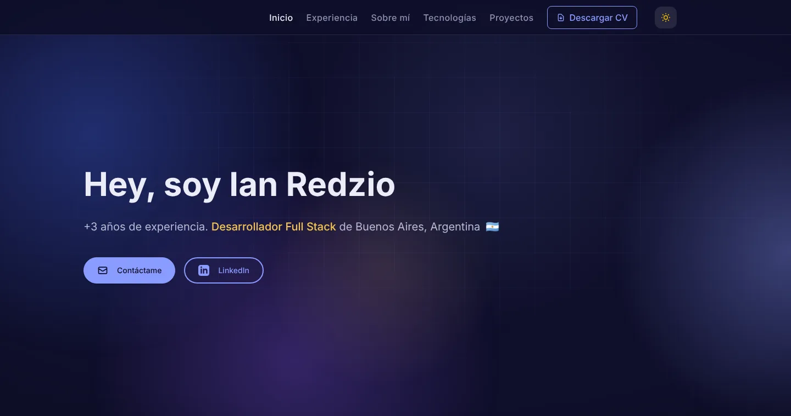
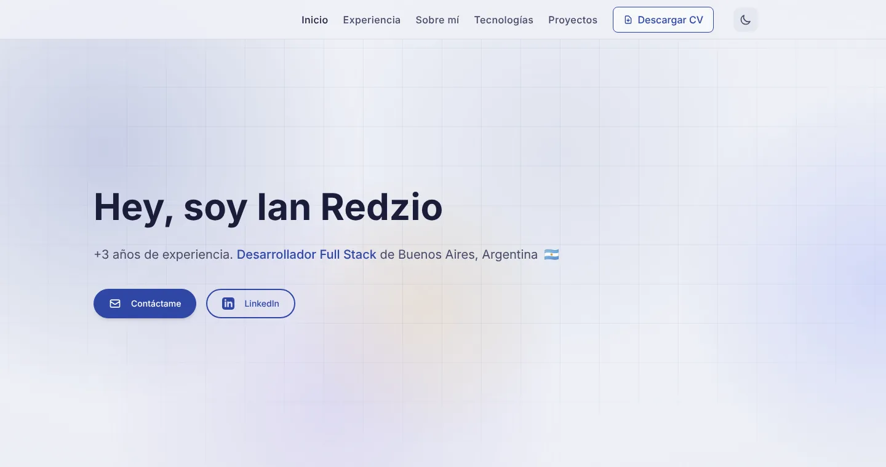

# 🚀 Portfolio Personal - Ian Redzio

Portfolio personal desarrollado con **Astro** y **Tailwind CSS**, presentando mis proyectos, experiencia profesional y habilidades técnicas como Desarrollador Full Stack.

🔗 **Demo:** [ianredzio-portfolio.vercel.app](https://ianredzio-portfolio.vercel.app/)

| Modo oscuro | Modo claro |
| --- | --- |
|  |  |

## ✨ Características

- 🔤 **Tipografía propia**: Bricolage Grotesque para títulos, IBM Plex Sans para texto e IBM Plex Mono para datos, servidas desde el sitio (sin Google Fonts)
- 🖱️ **Navegación por secciones**: scroll a pantalla completa con rueda del mouse, swipe en móviles y menú con indicador de sección activa
- 🌓 **Modo oscuro/claro**: paletas derivadas del mismo navy de marca; sigue la preferencia del sistema y guarda la elección manual en `localStorage`. En oscuro, todo el texto supera un contraste de 7:1
- ⌨️ **Efecto de escritura** en la presentación del hero
- 📱 **Diseño responsivo**: optimizado para móvil, tablet y desktop, con alturas `dvh` para las barras dinámicas de los navegadores móviles
- ♿ **Accesibilidad**: link para saltar al contenido, focus visibles, `aria-label`, cierre del menú con `Esc` y movimiento reducido
- 📬 **Sección de contacto** con botón para copiar el email, links a LinkedIn y GitHub, y descarga del CV
- 📄 **Descarga de CV** desde la barra de navegación
- 🔍 **SEO y vista previa al compartir**: Open Graph, Twitter Card, URL canónica, datos estructurados (`Person`), `sitemap.xml` y `robots.txt`
- ⚡ **Sitio estático**: generado con Astro, sin JavaScript de framework en el cliente

## 🛠️ Tecnologías

- **[Astro](https://astro.build/)**: framework para sitios estáticos
- **[Tailwind CSS](https://tailwindcss.com/)**: estilos utility-first
- **[TypeScript](https://www.typescriptlang.org/)**: tipado en componentes y scripts
- **[Simple Icons](https://simpleicons.org/)**: íconos SVG de tecnologías
- **[Fontsource](https://fontsource.org/)**: fuentes autoalojadas

## 📦 Instalación

Requiere **Node.js 22.23.4 o superior** (lo exige Astro 7).

```bash
git clone https://github.com/IannRedzio/portfolio2.0.git
cd portfolio2.0
npm install
npm run dev
```

El sitio queda disponible en `http://localhost:4321`.

## 🧞 Scripts

| Comando           | Acción                                              |
| :---------------- | :-------------------------------------------------- |
| `npm run dev`     | Inicia el servidor de desarrollo                    |
| `npm run build`   | Genera el sitio estático en `./dist/`               |
| `npm run preview` | Sirve el build localmente para revisarlo            |

## 📁 Estructura

```text
├── public/
│   ├── images/                  # Capturas de los proyectos
│   ├── og-image.jpg             # Imagen de vista previa al compartir (1200×630)
│   ├── robots.txt / sitemap.xml
│   └── Ian-Redzio-CV-DevFullStack.pdf
├── docs/                        # Imágenes usadas solo en este README
└── src/
    ├── components/
    │   ├── Nav.astro                  # Navegación, menú móvil y cambio de tema
    │   ├── Hero.astro                 # Presentación
    │   ├── Experience.astro           # Datos de experiencia laboral
    │   ├── AboutMe.astro
    │   ├── TechStack.astro            # Listado de tecnologías
    │   ├── Projects.astro             # Datos de proyectos
    │   └── Contact.astro              # Contacto y pie de página
    ├── layouts/Layout.astro      # HTML base, meta tags y script de tema
    ├── styles/global.css         # Variables de color y estilos de las secciones
    ├── utils/fullpage-navigation.ts   # Navegación por secciones
    └── pages/index.astro
```

## ✏️ Personalización

- **Experiencia, proyectos y tecnologías**: editar los arrays al inicio de `Experience.astro`, `Projects.astro` y `TechStack.astro`.
- **Colores**: la paleta está en `tailwind.config.mjs` (`paper`, `ink`, `brand`, `night`, `mist`, `signal`).
- **Tipografías**: se importan en `Layout.astro` y se nombran en `fontFamily` (`sans`, `display`, `mono`) de `tailwind.config.mjs`.
- **Proyecto destacado**: marcar con `featured: true` en `Projects.astro` el que se muestra en grande.
- **CV**: reemplazar el PDF en `public/` y actualizar el link en `Nav.astro` y `Contact.astro`.
- **Dominio**: si cambia la URL del sitio, actualizar `site` en `astro.config.mjs`, `public/robots.txt` y `public/sitemap.xml`.

## 📬 Contacto

- **Email:** [ianredzio13@gmail.com](mailto:ianredzio13@gmail.com)
- **LinkedIn:** [linkedin.com/in/ian-redzio](https://linkedin.com/in/ian-redzio)
- **GitHub:** [@IannRedzio](https://github.com/IannRedzio)
